<div align="center">

# LocalDock

**A tactile macro dock for your Windows PC, living on your iPhone.**
Tap a key, your PC does it. Local network only, PIN paired, no cloud.

[](https://github.com/CenkCey/localdock/actions/workflows/ci.yml)

-black)


[Türkçe](README.tr.md) · [Protocol](docs/protocol.md) · [Architecture](docs/architecture.md) · [Security](SECURITY.md)

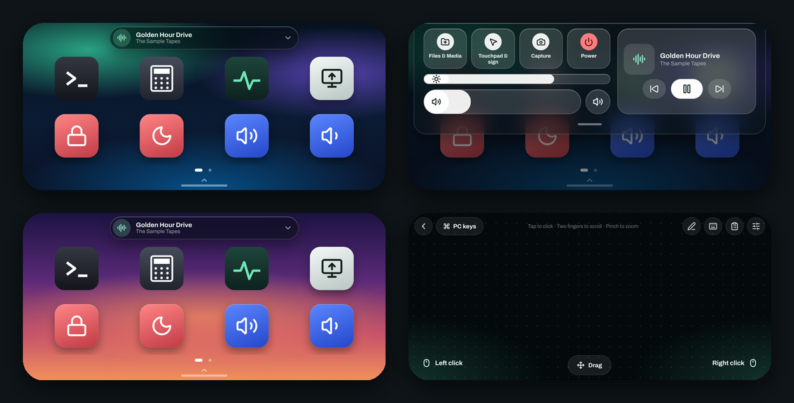

</div>

## What it is

LocalDock turns an iPhone into a customizable control surface for a Windows PC. Think of a hardware macro pad, but made of glass and software. Launch apps, control volume and media, move the mouse, type, share the clipboard, take screenshots and send files, all over your own Wi-Fi.

- **Dock of keys.** Launch any installed app (including Microsoft Store apps), open folders and links, run built-in actions. Multiple pages, reorder or remove keys, 4, 6 or 8 keys per page. Built for landscape.
- **Quick controls.** Volume, brightness, media transport and now-playing info on the dock header.
- **Touchpad and keyboard.** Mouse, two finger scroll, pinch to zoom, drag, PC shortcut keys and typing from the phone.
- **Clipboard, files, capture.** Push text to the PC clipboard, upload files, grab a screenshot or send a handwritten signature.
- **Glass design.** Eight backgrounds, clear, frosted or smoked glass, optional immersive and performance modes.
- **Windows tray app.** Shows the address and PIN, lists connected phones, revokes trust, starts with Windows.
- **Private by design.** Works on the local network only. A PIN pairs a phone once, afterwards a revocable token is used. See [SECURITY.md](SECURITY.md).

## Screenshots

| Connect | Pair with PIN |
|:--:|:--:|
| 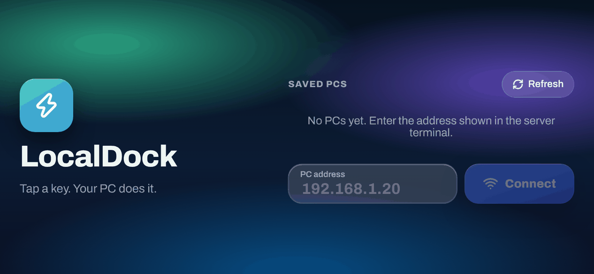 | 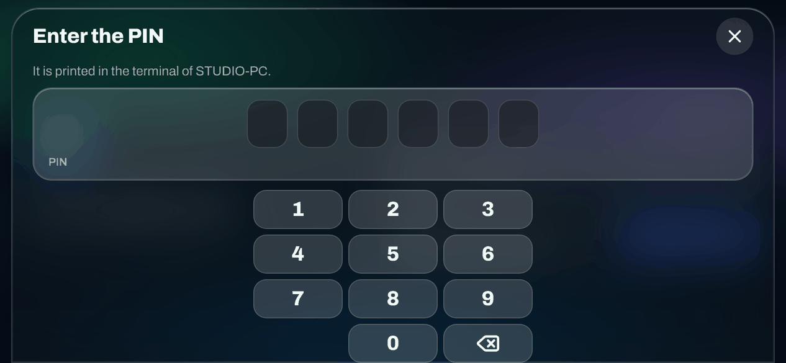 |

| Dock | Second page |
|:--:|:--:|
| 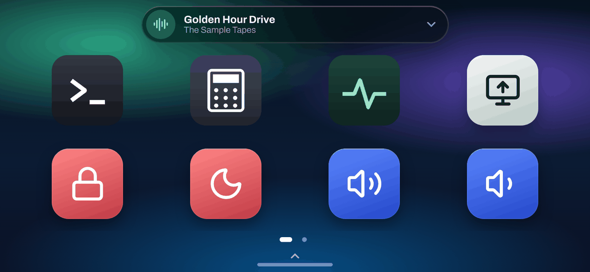 | 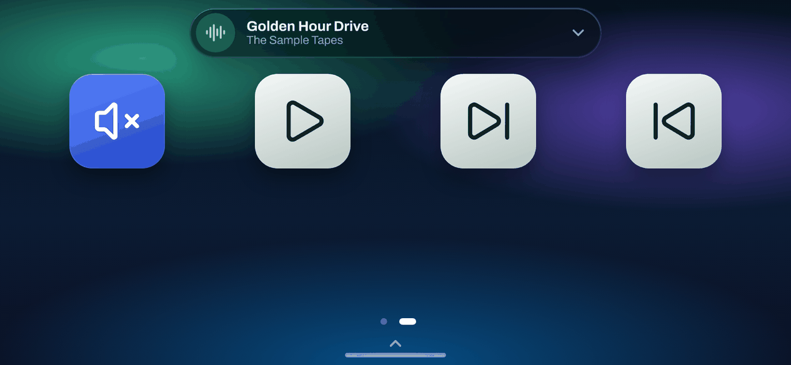 |

| Quick controls | Touchpad |
|:--:|:--:|
| 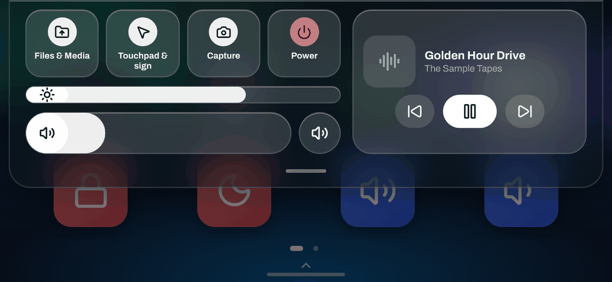 | 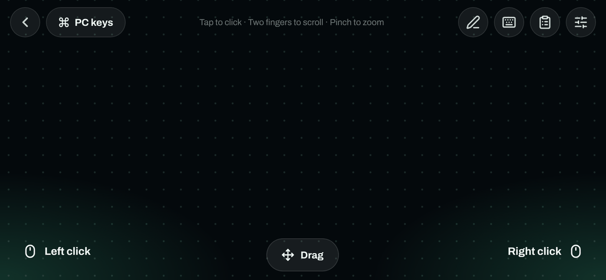 |

| Menu | Add to dock |
|:--:|:--:|
| 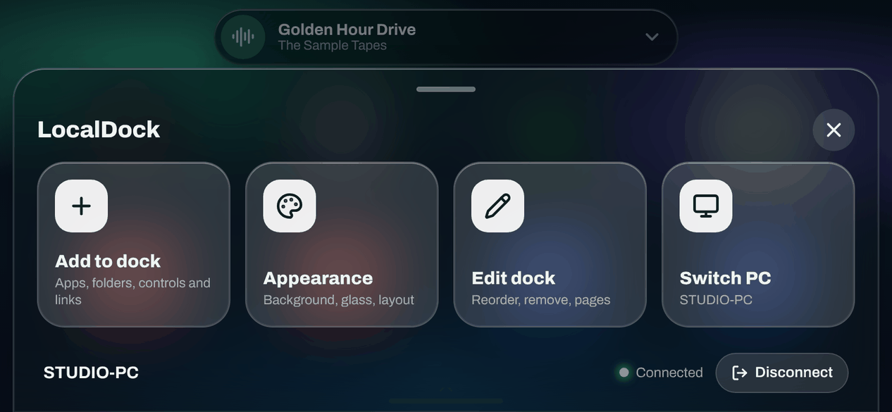 | 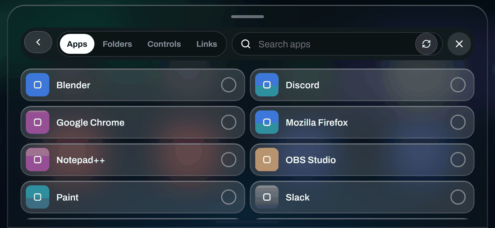 |

| Appearance | Edit dock |
|:--:|:--:|
| 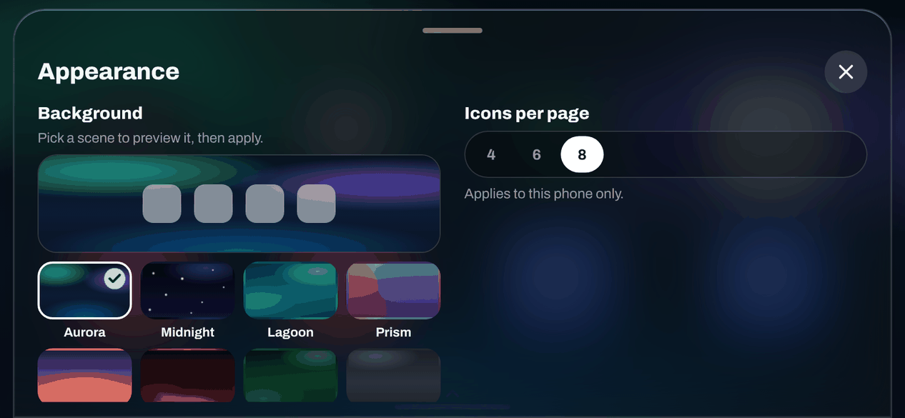 | 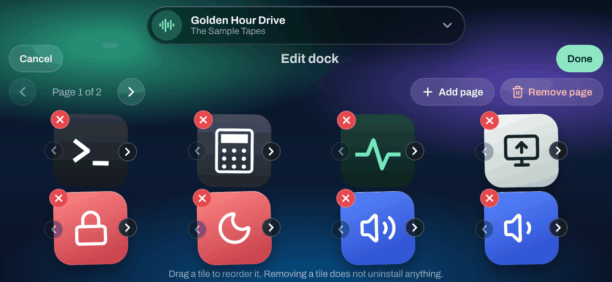 |

| Scene: Dusk | Scene: Midnight |
|:--:|:--:|
| 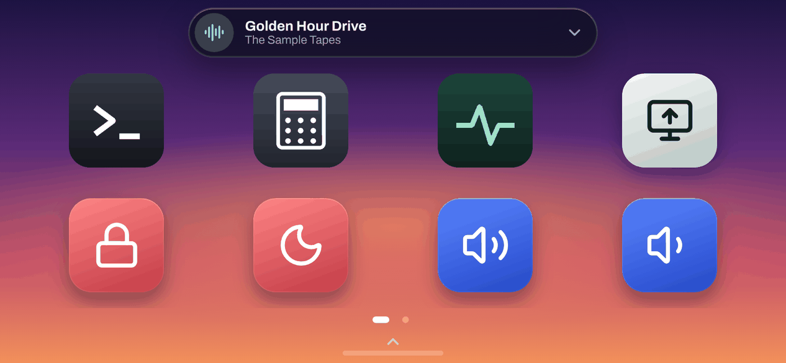 | 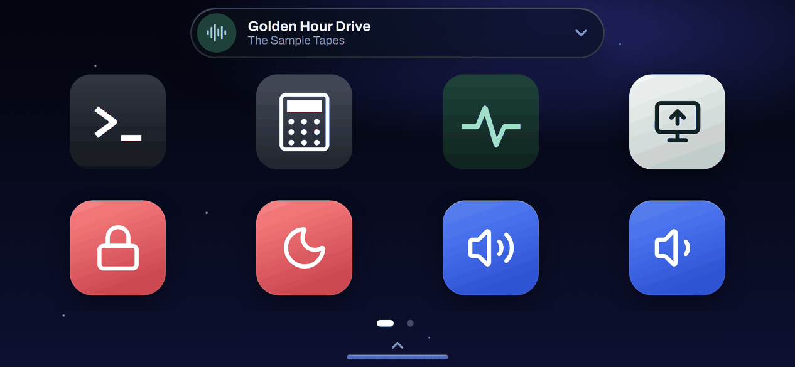 |

**Windows tray panel**

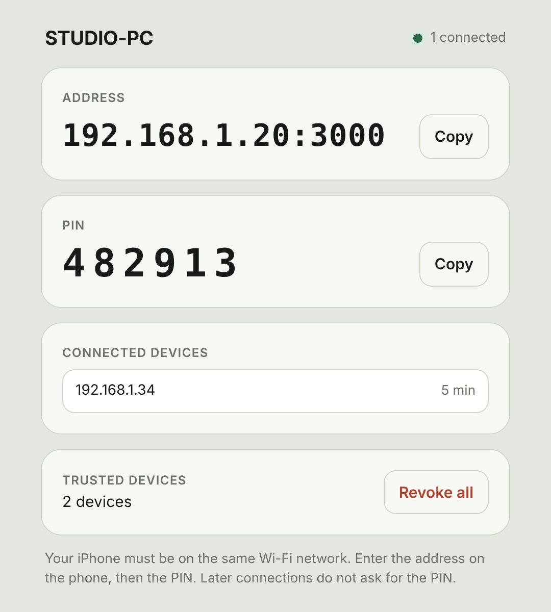

## How it works

```
iPhone (React + Capacitor)  <--- Socket.io over LAN --->  Node server  --->  LocalDock.Helper.exe (C#)
                                                          (PIN, tokens)       volume, media, clipboard,
                                                               |              screenshots, app icons
                                                      LocalDock.exe tray app
```

1. The PC runs a small Node.js server. A native C# helper does the Windows-specific work.
2. The phone connects to `PC-address:3000` and sends the 6 digit PIN shown on the PC.
3. The server answers with a token. Only its SHA-256 hash is stored on the PC, so the phone stays paired across restarts.
4. Every key press is a typed event. The full list is in [docs/protocol.md](docs/protocol.md).

More in [docs/architecture.md](docs/architecture.md).

## Quick start

### 1. PC (Windows 10/11)

Requirements: [Node.js 18+](https://nodejs.org) and [.NET SDK 10](https://dotnet.microsoft.com/download).

```bash
git clone https://github.com/CenkCey/localdock.git
cd localdock
cd server && npm install && cd ..
desktop\build-desktop.bat
```

The script builds the helper and the tray app, starts them and opens the panel with your address and PIN. Allow Node.js through Windows Firewall on **private networks** when asked.

Prefer a console? Run `server\start-server.bat` instead.

### 2. iPhone (Mac with Xcode)

Requirements: Node.js 22+, Xcode 26+, an Apple ID for signing.

```bash
cd client
npm install
npm run ios
```

In Xcode, open the **App** target, set your own **Team** and a unique **Bundle Identifier** under *Signing & Capabilities*, pick your iPhone and press Run. Details: [docs/setup-ios.md](docs/setup-ios.md).

### 3. Connect

Phone and PC must be on the same Wi-Fi. Hold the phone in landscape, enter the address shown in the PC panel, then the PIN. Later connections need no PIN.

## Using LocalDock

| Do this | Result |
|---|---|
| Tap a key | Runs the action or opens the app on the PC |
| Swipe the dock | Next page |
| Tap the media bar at the top | Quick controls: volume, brightness, media, files, touchpad, capture, power |
| Tap the handle at the bottom | Menu: add to dock, appearance, edit dock, switch PC |
| Menu, then Add to dock | Add apps, folders, built-in controls or links |
| Menu, then Edit dock | Reorder, remove, add pages |
| Menu, then Appearance | Background, glass style, keys per page, app names, immersive and performance modes |

Power actions (shutdown, restart) ask for confirmation first.

## Development

```bash
cd server && npm test
cd client && npm test
node test/e2e.mjs
```

`LOCALDOCK_DEV=1 npm start` runs the server on any OS with fake data, so you can work on the client without a Windows PC. `npm run fake` in `client` starts a fake server for UI work.

Project layout:

```
client/    React + Vite + Capacitor iOS app
server/    Node server, Windows helper (C#), tests
desktop/   Windows tray app (.NET + WebView2)
docs/      Protocol, architecture, setup guides
test/      End to end test
```

## Troubleshooting

See [docs/troubleshooting.md](docs/troubleshooting.md). The common ones: firewall on a public network profile, phone and PC on different Wi-Fi networks, a missing .NET SDK, or antivirus blocking an unsigned helper.

## Roadmap

- QR code pairing
- Android client
- Signed Windows releases

## Contributing

Issues and pull requests are welcome. Read [CONTRIBUTING.md](CONTRIBUTING.md) first. Report vulnerabilities privately as described in [SECURITY.md](SECURITY.md).

## License

[MIT](LICENSE)
