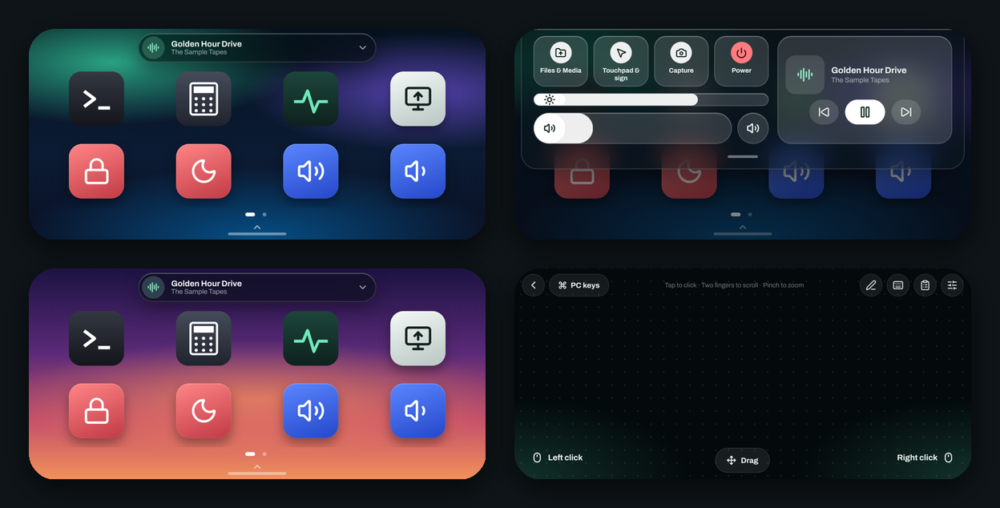

<div align="center">

# LocalDock

**Windows bilgisayarın için iPhone'da yaşayan dokunsal makro dock.**
Bir tuşa dokun, bilgisayarın yapsın. Sadece yerel ağ, PIN ile eşleşme, bulut yok.

[English](README.md) · [Protokol](docs/protocol.md) · [Mimari](docs/architecture.md) · [Güvenlik](SECURITY.md)



</div>

## Nedir

LocalDock, iPhone'u Windows bilgisayar için özelleştirilebilir bir kontrol yüzeyine çevirir. Donanımsal bir makro pad gibi düşün, ama cam ve yazılımdan. Uygulama aç, ses ve medyayı yönet, fareyi oynat, yaz, panoyu paylaş, ekran görüntüsü al ve dosya gönder. Hepsi kendi Wi-Fi ağın üzerinden.

- **Tuş dock'u.** Kurulu her uygulamayı (Microsoft Store dahil), klasörleri ve bağlantıları aç, hazır eylemleri çalıştır. Çok sayfa, sürükleyerek sıralama, sayfa başına 4, 6 veya 8 tuş.
- **Hızlı kontroller.** Ses, parlaklık, medya kontrolü ve çalan parça bilgisi.
- **Touchpad ve klavye.** Fare, iki parmakla kaydırma, kıstırarak yakınlaştırma, sürükleme, PC kısayol tuşları ve yazma.
- **Pano, dosya, ekran.** Metni PC panosuna gönder, dosya yükle, ekran görüntüsü al, imza gönder.
- **Cam tasarım.** Sekiz arka plan, şeffaf, buzlu veya füme cam, isteğe bağlı sürükleyici ve performans modu.
- **Windows tepsi uygulaması.** Adresi ve PIN'i gösterir, bağlı telefonları listeler, güveni iptal eder, Windows ile açılır.
- **Gizlilik odaklı.** Yalnızca yerel ağda çalışır. Telefon PIN ile bir kez eşleşir, sonra iptal edilebilir bir token kullanılır. Bkz. [SECURITY.md](SECURITY.md).

## Ekran görüntüleri

Görseller için [İngilizce README](README.md#screenshots) sayfasına bak.

## Hızlı başlangıç

### 1. PC (Windows 10/11)

Gereksinimler: [Node.js 18+](https://nodejs.org) ve [.NET SDK 10](https://dotnet.microsoft.com/download).

```bash
git clone https://github.com/CenkCey/localdock.git
cd localdock
cd server && npm install && cd ..
desktop\build-desktop.bat
```

Betik yardımcıyı ve tepsi uygulamasını derler, başlatır ve adres ile PIN'in olduğu paneli açar. İstendiğinde Node.js'e Windows Güvenlik Duvarı'nda **özel ağlar** için izin ver.

Konsol tercih edersen `server\start-server.bat` çalıştır.

### 2. iPhone (Xcode'lu Mac)

Gereksinimler: Node.js 22+, Xcode 26+, imzalama için Apple ID.

```bash
cd client
npm install
npm run ios
```

Xcode'da **App** hedefinde *Signing & Capabilities* altında kendi **Team** değerini ve benzersiz bir **Bundle Identifier** seç, iPhone'u seç ve Run'a bas. Ayrıntı: [docs/setup-ios.md](docs/setup-ios.md).

### 3. Bağlan

Telefon ve PC aynı Wi-Fi'da olmalı. Telefonu yatay tut, PC panelindeki adresi, sonra PIN'i gir. Sonraki bağlantılar PIN istemez.

## Geliştirme

```bash
cd server && npm test
cd client && npm test
node test/e2e.mjs
```

`LOCALDOCK_DEV=1 npm start` sunucuyu sahte verilerle her işletim sisteminde çalıştırır.

## Sorun giderme

[docs/troubleshooting.md](docs/troubleshooting.md)

## Lisans

[MIT](LICENSE)
